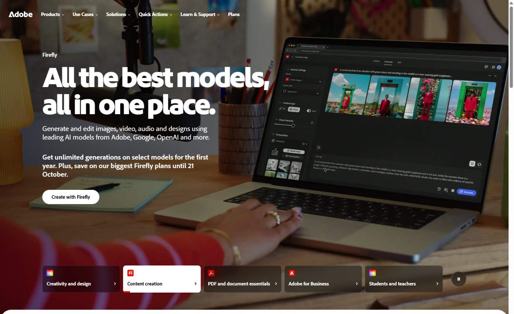
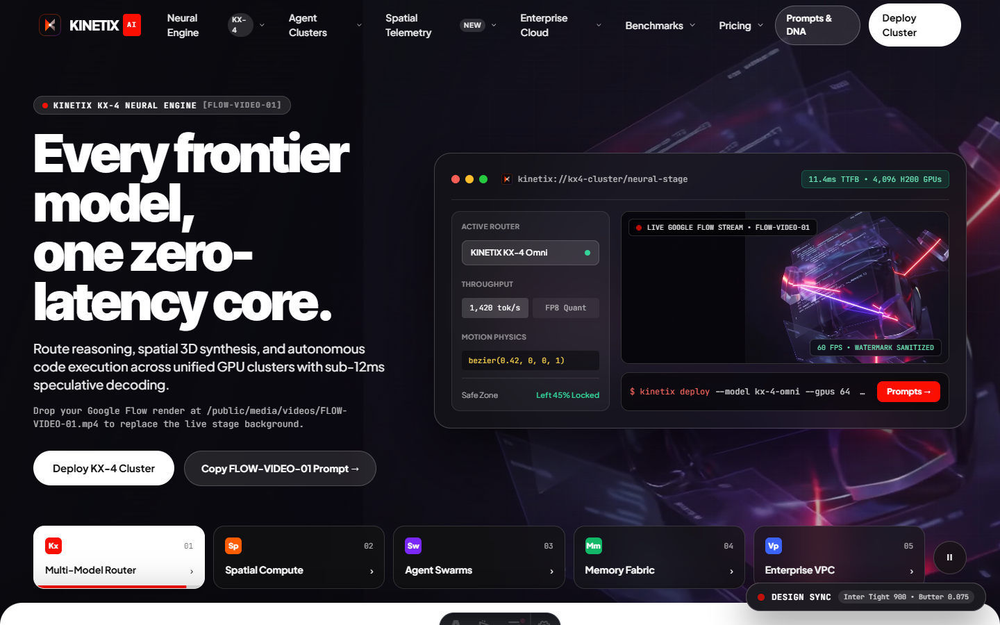
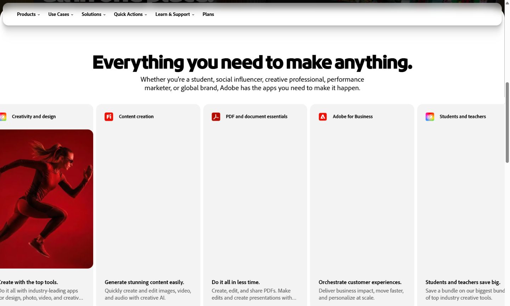
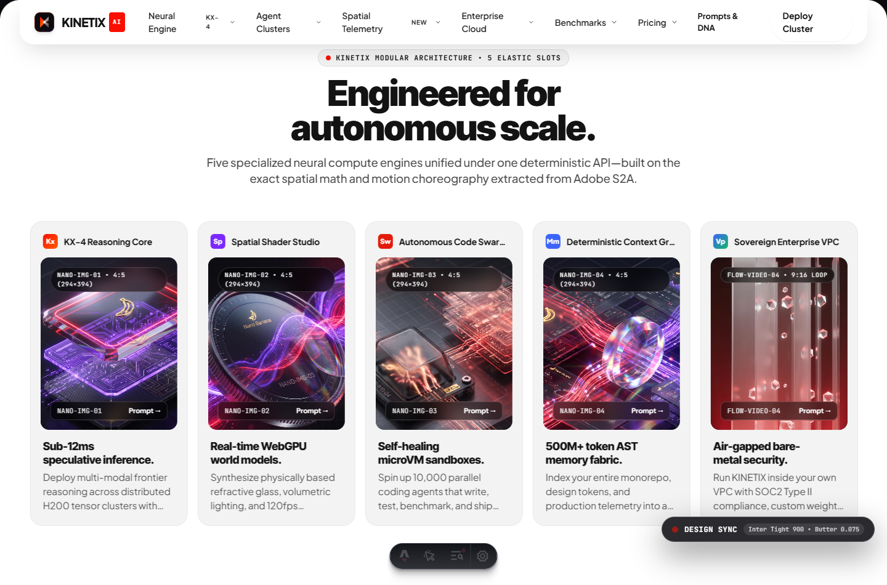

<div align="center">

# DESIGN FORGE

**Autonomous Frontend Reverse-Engineering & Design System Compiler**

[](./LICENSE)
[](./extractor)
[](./sites/adobe-showcase)
[](./tsconfig.json)

<p align="center">
  Point Design Forge at any production URL. It launches an instrumented Chromium instance over the Chrome DevTools Protocol (CDP), probes computed design tokens, captures Web Animations API & CSS scroll physics, maps asymmetric Bento & carousel DOM topologies, and compiles a hot-swappable <strong>Astro + GSAP + Lenis</strong> flagship site.
</p>

</div>

---

## Visual Overview

| Extracted Reference Stage | Recompiled Flagship Showcase (`KINETIX AI`) |
| :---: | :---: |
|  |  |
|  |  |

---

## Architecture

Design Forge separates **extraction telemetry** from **brand synthesis** across four deterministic stages:

```text
Target URL (e.g., https://www.adobe.com)
   │
   ├─► [1. CDP & DOM Probes] (extractor/probes/)
   │     ├── tokens-probe.ts    → Extracts CSS custom properties, fluid type scales, surfaces, radii & shadows
   │     ├── motion-probe.ts    → Hooks document.getAnimations(), cubic-bezier curves, keyframes & scroll triggers
   │     ├── layout-probe.ts    → Maps section bounding boxes, grid columns, safe zones & crops section PNGs
   │     └── media-probe.ts     → Audits <video>, <picture>, aspect ratios, object-fit & focal points
   │
   ├─► [2. Design System Compiler] (extractor/compiler/)
   │     ├── compile-tokens.ts  → Generates tokens.json, tokens.css & tailwind.preset.mjs
   │     ├── compile-motion.ts  → Synthesizes Lenis + GSAP ScrollTrigger choreography (gsap-choreography.ts)
   │     ├── compile-prompts.ts → Builds aspect-ratio-locked Google Flow (Veo) & Nano Banana 3D prompts
   │     └── compile-context.ts → Compiles AI-CONTEXT.md architectural specification
   │
   ├─► [3. Media Sanitizer & Asset Pipeline] (extractor/clean-media.ts)
   │     └── Automated FFmpeg Lanczos crop-and-scale filter that strips bottom-right AI watermarks
   │
   └─► [4. Visual Diff & Parity Auditor] (extractor/visual-diff.ts)
         └── Renders the compiled Astro showcase at 1440×900, verifies computed font weights/tracking, and exports side-by-side section captures
```

---

## Repository Structure

```text
design-forge/
├── extractor/                          # Playwright + CDP reverse-engineering engine
│   ├── index.ts                        # CLI entry point for live URL extraction
│   ├── browser.ts                      # Local Chrome / Edge CDP executable resolver
│   ├── clean-media.ts                  # FFmpeg Lanczos watermark sanitizer for video & image slots
│   ├── visual-diff.ts                  # Automated visual parity & typography telemetry auditor
│   ├── probes/                         # In-page DOM & CDP runtime probes
│   │   ├── tokens-probe.ts
│   │   ├── motion-probe.ts
│   │   ├── layout-probe.ts
│   │   └── media-probe.ts
│   └── compiler/                       # AST & stylesheet code generators
│       ├── compile-tokens.ts
│       ├── compile-motion.ts
│       ├── compile-prompts.ts
│       └── compile-context.ts
├── design-systems/
│   └── adobe/                          # Extracted S2A design system & reusable Astro blueprints
│       ├── AI-CONTEXT.md               # Complete token, grid, and motion specification
│       ├── tokens/                     # tokens.css, tokens.json, tailwind.preset.mjs
│       ├── motion/                     # motion-dna.json & gsap-choreography.ts
│       ├── blueprints/components/      # MegaNav, HeroStage, ElasticCarousel, BentoShowcase, SyncController
│       ├── media-prompts/              # Aspect-ratio-matched video & 3D render prompt playbooks
│       └── reference-captures/         # Original viewport & per-section PNG captures
└── sites/
    └── adobe-showcase/                 # Live Astro + Tailwind + GSAP + Lenis flagship showcase
        ├── src/pages/index.astro       # KINETIX AI flagship landing page
        ├── src/pages/design-system.astro # Interactive token explorer & 1-click prompt playbook
        └── public/media/               # Hot-swappable video & 3D image slots
```

---

## Quick Start

### Prerequisites
- **Node.js** `>= 20.x`
- **Google Chrome** or **Microsoft Edge** (used by `playwright-core` for zero-download local CDP extraction)
- **FFmpeg** (optional, required only for `npm run clean:media` watermark sanitization)

### 1. Install Dependencies

```bash
npm install
npm --prefix sites/adobe-showcase install
```

### 2. Launch the Live Showcase & Design System Explorer

```bash
npm run dev:showcase
```

- **Flagship Showcase (`KINETIX AI`):** `http://localhost:4321/`
- **Interactive Token Explorer & Prompt Playbook:** `http://localhost:4321/design-system`

### 3. Extract Any Reference Website

Point the extractor at any live production URL to generate a complete `design-systems/<slug>/` package:

```bash
npx tsx extractor/index.ts https://example.com --name example
```

### 4. Sanitize Generated Media Assets

Drop generated `.mp4` or `.png` renders into `sites/adobe-showcase/public/media/` and run the FFmpeg Lanczos sanitizer to remove corner watermarks while preserving native resolution:

```bash
npm run clean:media
```

### 5. Run the Visual Parity & Telemetry Audit

```bash
npx tsx extractor/visual-diff.ts http://localhost:4321/
```

---

## Live 4-Pillar Design Sync Controller

The showcase includes an interactive floating **Design Sync Dock** (`SyncController.astro`) that mutates CSS custom properties and physics parameters at runtime:

1. **Optical Typography Presets:** Switch live between `S2A Tight (Inter Tight 900)`, `Geometric (Plus Jakarta Sans 800)`, `Editorial Tech (Space Grotesk 700)`, and `Avant-Garde (Syne 800)`.
2. **Motion Physics:** Toggle Lenis smooth-scroll lerp (`0.075` Butter vs. `0.14` Snappy), adjust scroll-scrubbed hero parallax intensity, and test `cubic-bezier(0.42, 0, 0, 1)` elastic hover curves.
3. **Semantic Brand Palettes:** Hot-swap accent tokens (`Crimson #FA0F00`, `Electric Violet #7A28FF`, `Emerald Matrix #12B867`, `Cobalt Core #3B63FB`).
4. **X-Ray Blueprint Inspector:** Overlay live DOM grid boundaries, safe-zone ratios, and asset slot IDs directly over the rendered page.

---

## License

Released under the [MIT License](./LICENSE).

---

<div align="center">
  <sub>Made by Claude • Co-Authored with <a href="https://claude.com/claude-code">Claude Code</a></sub>
</div>
